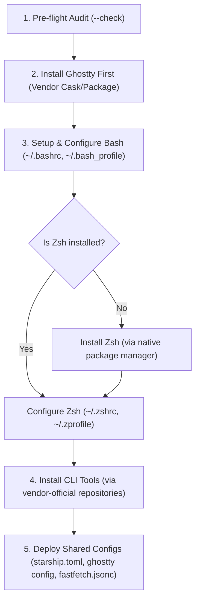

# Multi-Platform Terminal Setup Skill (Vendor Package Manager Driven)

This skill provides an automated, cross-platform procedure for configuring, inspecting, and deploying a modern terminal environment across **macOS** and **Linux distributions** (openSUSE, Fedora, Debian, Ubuntu, Arch).

## Core Principle: Official Vendor Package Repositories Only

All tools must be installed through the **distribution's native package manager** (`brew`, `zypper`, `dnf`, `apt`, `pacman`) using repositories maintained directly by the **official vendor/maintainer**:
1. Keeps the environment fully robust, auditable, and cleanly registered in the system package database.
2. Allows universal updates with the standard OS update flow (`brew upgrade`, `dnf upgrade`, `zypper update`, `apt upgrade`).
3. Eliminates random unversioned binary downloads or untracked scripts.

---

## Official Vendor Documentation & Repository Matrix

Tool & Vendor               | macOS (`brew`)           | Fedora (`dnf`)                                       | openSUSE (`zypper`)               | Debian / Ubuntu (`apt`)
:-------------------------- | :----------------------- | :--------------------------------------------------- | :-------------------------------- | :----------------------
**Ghostty**<br>*(ghostty.org)* | `brew install --cask ghostty` | `dnf copr enable scottames/ghostty`<br>*(Official Ghostty doc)* | `zypper in ghostty`<br>*(Official openSUSE OSS)* | Native package (26.04+) or official vendor `.deb` / Flathub
**Starship**<br>*(starship.rs)* | `brew install starship` | `dnf copr enable atim/starship`<br>*(Official Starship doc)* | `zypper in starship`<br>*(Official openSUSE OSS)* | `apt install starship` (Debian 13+ / Ubuntu 25.04+)
**eza**<br>*(eza-community)* | `brew install eza`      | `dnf install eza`<br>*(Official Fedora core)*        | `zypper in eza`<br>*(Official openSUSE OSS)*      | Official vendor repo `deb.gierens.de`<br>*(eza INSTALL.md)*
**Fastfetch**<br>*(fastfetch-cli)* | `brew install fastfetch`| `dnf install fastfetch`<br>*(Official Fedora core)*  | `zypper in fastfetch`<br>*(Official openSUSE OSS)*| Native package or author's official PPA (`ppa:zhangsongcui3371/fastfetch`)
**Zsh & Plugins**<br>*(zsh-users)* | `brew install zsh ...`  | `dnf install zsh ...`<br>*(Official Fedora core)*    | `zypper in zsh ...`<br>*(Official openSUSE OSS)*  | `apt install zsh ...`<br>*(Official Debian/Ubuntu core)*

---

## Execution Sequence



1. **Pre-flight Audit**: Inspects system architecture, package manager, installed shells, tools, and configs.
2. **Ghostty Installed First**: Deploys Ghostty and validates `~/.config/ghostty/config`.
3. **Bash Configured First**: Deploys `~/.bashrc` and `~/.bash_profile` so the user immediately gets `eza` aliases and Starship prompt capabilities even before Zsh is installed.
4. **Zsh Installed & Configured**: If Zsh is not present, it installs it via the platform package manager and deploys `~/.zshrc` / `~/.zprofile`.
5. **CLI Tools & Shared Configurations**: Installs `eza`, `starship`, `fastfetch`, and plugins from vendor repos, deploying `~/.config/starship.toml` and `~/.config/fastfetch/config.jsonc`.

---

## Commands for Agents

### 1. Audit / Inspection Mode (Safe, Read-Only)
```bash
~/.agents/skills/terminal-setup/scripts/verify-or-install.sh --check
```

### 2. Apply Mode
```bash
# Interactive (prompts before applying):
~/.agents/skills/terminal-setup/scripts/verify-or-install.sh --apply

# Automated non-interactive mode:
~/.agents/skills/terminal-setup/scripts/verify-or-install.sh --apply -y
```

---

## Developer Environment & Prompt Modules

Starship prompt dynamically activates developer modules based on project context:
- **Application Package Version (`󰏗`)**: Reads the application version directly from `package.json` (with `display_private = true` so private applications are supported).
- **React (``)**: Distinct React atom glyph in cyan (`#89dceb`), triggered when React/Next.js dependencies exist in `package.json`.
- **Angular (``)**: Distinct Angular shield glyph in red (`#f38ba8`), triggered on `angular.json` or `@angular/*` packages.
- **Vue.js (`󰡄`)**: Distinct Vue logo in emerald green (`#a6e3a1`).
- **Node.js (``)**: Node hexagon in green (`#a6e3a1`), displaying active Node version.
- **Bun (``) & Deno (``)**: Modern JavaScript/TypeScript alternative runtimes.
- **Go (``)**: Active when inside Go projects (`go.mod`, `go.work`, `*.go`), displaying Go compiler version.
- **Terraform (`󱁢`)**: Active when inside a directory with `.tf` or `.terraform` files, displaying the current workspace.

---

## Canonical Resource Templates

All templates reside in `~/.agents/skills/terminal-setup/resources/`:
- `bash_profile.template` & `bashrc.template`
- `zprofile.template` & `zshrc.template`
- `ghostty.config.template`
- `starship.toml.template`
- `fastfetch.jsonc.template`
